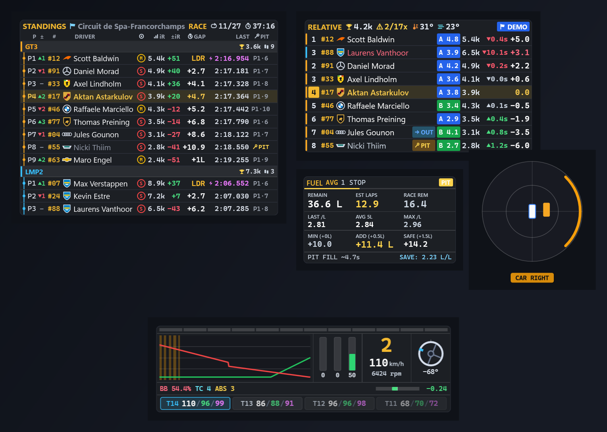
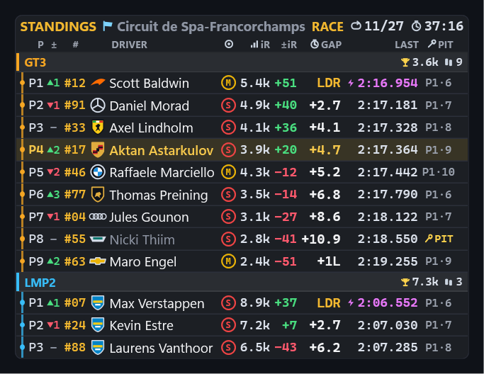
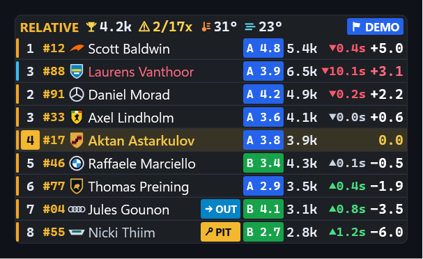
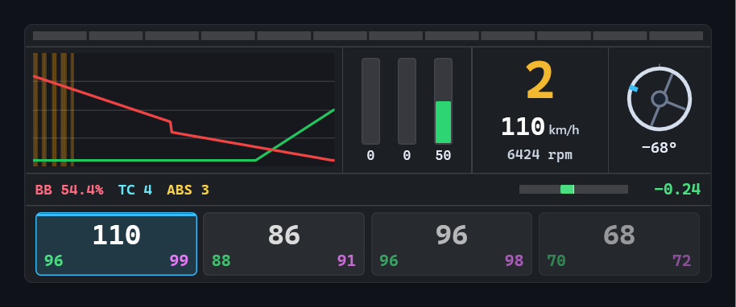
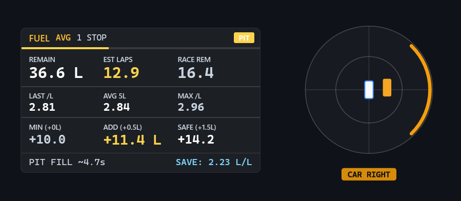
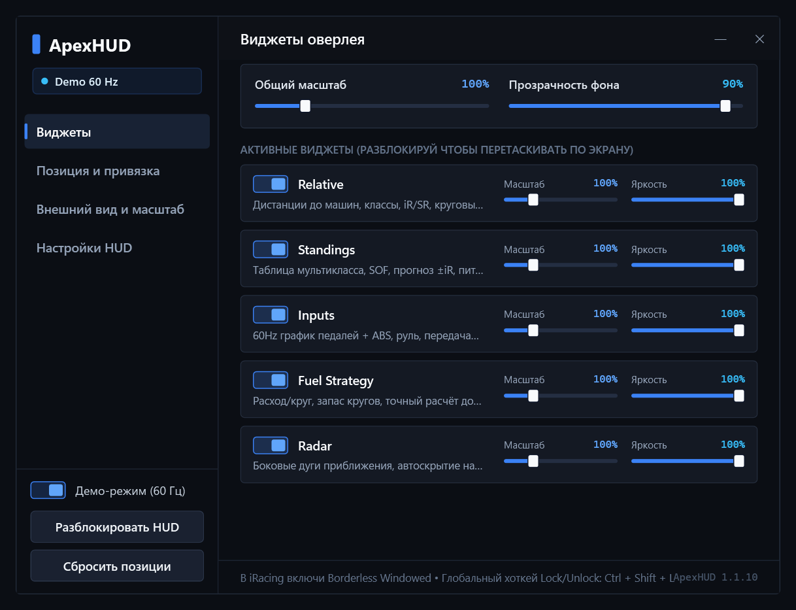

# Z-Overlay (ApexHUD) — Native Telemetry Overlay for iRacing


Ультра-лёгкий, нативный и бесплатный оверлей телеметрии для **iRacing** на **C# / .NET 6 (WPF + прямое чтение Shared Memory на 60 Гц)** — без Electron, без Chromium, без подписок и без просадок FPS.

Поддерживает **2 темы оформления** в 1 клик: **iRacing Native** (бесшовная стилистика нового интерфейса iRacing 2026: матовый графит, золотой акцент, тонкие разделители и вертикальная классовая линия с нодами) и **Apex Carbon**.

<p align="center">
  
</p>

---

## Виджеты

### Standings (Multiclass)

<p align="center">
  
</p>

- Полный **мультикласс** с расчётом **SOF** по каждому классу, вертикальной классовой линией с нодами и нативной золотой подсветкой игрока
- В **Practice / Qualifying** автоматически сортирует по **Fastest Lap (`BEST`)** из результатов сессии (даже если машины в боксах) и скрывает колонку `±iR`
- В **Race** — живой прогноз **`±iR`** (формула Elo iRacing), отыгранные/потерянные позиции (`▲2` / `▼1`), переключение **Gap / Interval**, пит-стопы и длина стинта (`P1·8` / `L11`)
- Векторные иконки 19+ марок авто (**Porsche, Ferrari, BMW, Mercedes-AMG, Audi, McLaren, Lamborghini, Ford, Chevrolet/Corvette, Aston Martin, Acura, Honda, Cadillac, Toyota, Mazda, Dallara, Hyundai, Lotus, Formula**), бейджи шин (`S / M / H / W / D`) и фиолетовый лучший круг класса

### Relative

<p align="center">
  
</p>

- Ближайшие машины спереди и сзади с точными отрывами в секундах (`CarIdxEstTime`) и динамической авто-шириной колонок (имена и фамилии никогда не обрезаются)
- Разница темпа относительно тебя (`▼0.4s` красным, если накатывает / `▲0.5s` зелёным, если медленнее)
- Раскраска круговых (`Cyan`) и обгоняющих на круг (`Red/Rose`), статусы `PIT`, `OUT` (холодная резина после выезда) и `OFF`
- Бейджи лицензии / Safety Rating, iRating, SOF, инциденты, температура трека/воздуха, `WET` и флаги

### Input Telemetry

<p align="center">
  
</p>

- **100% модульный виджет** — каждый блок включается и выключается независимо в настройках (график, бары педалей, передача/скорость/RPM, шифт-бар, руль, `BB / TC / ABS`, Delta Bar, полоса минимальных скоростей)
- 60 FPS аппаратный график газа / тормоза / сцепления с полосами срабатывания **ABS**, настраиваемой шириной (`140–460 px`) и длиной окна (**`1.0 – 12.0 сек`**)
- **Полоса 4 последних поворотов (Corner Min Speed)** в стиле Racelab — 4 последних пройденных поворота слева направо с цветовой индикацией: **белый** (текущий проезд), **зелёный** (твой личный рекорд сессии), **фиолетовый** (абсолютный рекорд сессии)
- 12-сегментный LED шифт-бар с вспышкой на отсечке, педали с `%`, векторный руль, нижняя полоска электроники (**`BB`**, **`TC`**, **`ABS`**) и встроенный **Delta Bar**

### Fuel Strategy & Radar / Blind Spot

<p align="center">
  
</p>

- **Fuel Strategy**: точный трекер расхода (фильтрует пит-стопы и неполные круги), 3 режима расчёта (**`AVG 5L` / `LAST` / `MAX`**), 3-колоночная матрица долива (**`MIN` | `ADD` | `SAFE`**), число пит-стопов (`NO STOP` / `1 STOP`), расчёт времени дозаправки и целевой расход на экономию (`SAVE`)
- **Radar / Blind Spot**: минималистичный радар с дугами **`CAR LEFT` / `CAR RIGHT` / `3 WIDE`**, задней дугой приближения (`<10 м`), дистанцией в метрах и **автоскрытием на чистой трассе** в Lock-режиме

---

## Центр управления (Hub) и кастомизация

<p align="center">
  
</p>

- **2 встроенные темы в 1 клик**: `iRacing Native` и `Apex Carbon` + раздельная прозрачность подложек (`0–95%`)
- **Автопоказ только при активном iRacing** — мгновенно скрывает все виджеты при `Alt+Tab` или сворачивании игры
- **Удобный ресайз и масштаб**: тяни любой виджет мышкой за правый край, нижний край или угол (`55% – 250%`), регулируй общий масштаб (`70% – 220%`) и внутренний размер шрифта (`80% – 135%`)
- **Позиционирование и мультимонитор**: выбор разрешённых мониторов, жёсткие границы экрана, сетка привязки **3×3**, магнитное прилипание (`≤ 14 px`) и точный сдвиг стрелками (`↑ ↓ ← →`, с `Shift` — 10 px)
- **Выбор шрифтов**: 5 пресетов (`iRacing Native`, `Modern`, `Bahnschrift DIN`, `Rajdhani F1`, `Exo 2`) + любой установленный в Windows шрифт отдельно для текста и цифр
- **Встроенный Demo Mode (60 Гц)** — живая симуляция мультикласса GT3 + LMP2 в Спа для настройки без запуска iRacing

---

## Быстрый старт

1. Скачай из раздела **[Releases](https://github.com/astarkulov/z-overlay/releases/latest)** любой удобный вариант (требуется [.NET 6 Desktop Runtime](https://dotnet.microsoft.com/en-us/download/dotnet/6.0)):
   - **`Z-Overlay-Setup-v1.1.7.exe`** — классический установщик Windows (Inno Setup: ярлык на рабочий стол, опция автозапуска с Windows, чистая деинсталляция);
   - **`ApexHUD.exe`** — портативный однофайловый вариант (~395 КБ), работает без установки.
2. Запусти приложение — со старта включён **Демо-режим (60 Гц)**, чтобы сразу расставить виджеты, выбрать тему, масштаб, прозрачность и шрифты.
3. Нажми **Закрепить для гонки (`Ctrl + Shift + L`)** — все виджеты станут click-through.
4. Выключи **Демо-режим** в сайдбаре для перехода в **Live iRacing**.
5. В настройках графики iRacing включи **Borderless Windowed** (`Full Screen = off`, `Border = off`).

Настройки и позиции окон автоматически сохраняются в `%AppData%\ApexHUD\settings.json`.

---

## Сборка из исходников

Требуется [.NET 6 SDK](https://dotnet.microsoft.com/en-us/download/dotnet/6.0) (Windows x64):

```powershell
git clone https://github.com/astarkulov/z-overlay.git
cd z-overlay
dotnet publish ApexHUD.csproj -c Release -r win-x64 --self-contained false -p:PublishSingleFile=true -p:DebugType=None -p:DebugSymbols=false -o dist
```

Готовый однофайловый бинарник появится в `dist\ApexHUD.exe`.

Для сборки Windows-установщика (требуется [Inno Setup 6](https://jrsoftware.org/isinfo.php)):

```powershell
.\installer\build-installer.ps1
```

Установщик появится в `dist\Z-Overlay-Setup-v1.1.7.exe`.
