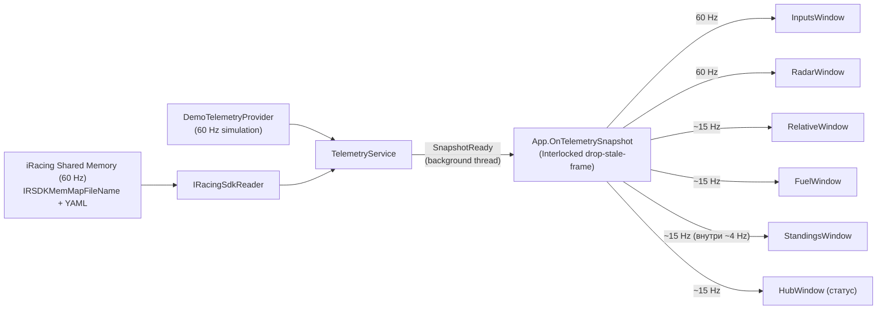

# Z-Overlay (ApexHUD) — Архитектура и документация разработчика

Этот документ содержит полное описание архитектуры, дизайн-системы, потоков данных и всех виджетов **Z-Overlay (ApexHUD)**, чтобы в любой новой сессии можно было мгновенно продолжить разработку без потери контекста.

- **Репозиторий:** https://github.com/astarkulov/z-overlay (ветка `main`)
- **Локальный путь проекта:** `C:\Users\Aktan\Documents\ApexHUD`
- **Стек:** C# / .NET 6 (`net6.0-windows`), WPF + минимальный WinForms (`NotifyIcon`, `Screen.AllScreens`), прямой бинарный ридер Shared Memory iRacing (`IRSDK`) — **0 внешних NuGet-зависимостей**.
- **Текущая версия:** `v1.1.12`

---

## 1. Карта проекта

```text
ApexHUD/
├── ApexHUD.csproj                    # Target net6.0-windows, UseWPF + UseWindowsForms, Version, AppIcon
├── App.xaml / App.xaml.cs            # Точка входа, Single-Instance Mutex + IPC, 60Hz->UI диспетчер, трей, crash.log
├── Assets/ApexHUD.ico                # Иконка приложения и установщика
├── Themes/MotorsportTheme.xaml       # Общие стили Control Hub (кнопки, слайдеры, тогглы, шрифты)
│
├── Core/
│   ├── Native/Win32.cs               # P/Invoke: WS_EX_TRANSPARENT|NOACTIVATE, RegisterHotKey, Foreground iRacing check, GetCursorPos
│   ├── Settings/AppSettings.cs       # Модель настроек + загрузка/сохранение %AppData%\ApexHUD\settings.json
│   ├── Updates/UpdateService.cs      # Автообновление в 1 клик через GitHub Releases API (установщик + portable)
│   ├── Diagnostics/
│   │   └── ScreenshotExporter.cs     # Флаг --capture-screenshots: рендер PNG и GIF89a (dirty-rect + NETSCAPE2.0)
│   └── Telemetry/
│       ├── TelemetrySnapshot.cs      # Все DTO телеметрии (Session, Inputs, Fuel, Relative, Standings, Radar)
│       ├── TelemetryService.cs       # Поток 60 Гц, бесшовное переключение Live IRSDK <-> Demo Mode
│       ├── IRacingSdkReader.cs       # Прямое чтение Local\IRSDKMemMapFileName + IRSDKDataValidEvent
│       ├── IRacingYamlParser.cs      # Парсер SessionInfo YAML (машины, классы, бренды, ResultsPositions)
│       ├── DemoTelemetryProvider.cs  # 60 Гц симулятор мультикласса GT3+LMP2 в Спа (обгоны, радар, педали)
│       ├── CornerSpeedTracker.cs     # Трекер 4 последних поворотов (T1..Tn) + снимок быстрого круга лидера класса
│       ├── FuelTracker.cs            # Расчёт расхода (AVG 5L / LAST / MAX), фильтрация питов, матрица долива
│       ├── IRatingEstimator.cs       # SOF и прогноз ±iR по формуле Elo iRacing
│       ├── CarBrand.cs               # Enum + маппинг названий авто iRacing на 19+ брендов
│       └── FormatHelpers.cs          # Форматирование времён, отрывов, iR (всегда InvariantCulture) + кэш FrozenBrush
│
├── Controls/                         # Лёгкие кастомные WPF-контролы (DrawingContext / zero-alloc)
│   ├── CarBrandIcon.cs               # Векторные логотипы 19+ марок авто
│   ├── HudMetricIcon.cs              # Векторные микро-иконки (флаг, кубок, секундомер, ключ, шина, молния и т.д.)
│   ├── InputGraphCanvas.cs           # 60 FPS кольцевой буфер газа/тормоза/сцепления + вертикальные полосы ABS
│   ├── ShiftLightBar.cs              # 12-сегментный LED шифт-бар с отсечкой
│   ├── SteeringWheelVisual.cs        # Векторный индикатор угла руля
│   └── RadarCanvas.cs                # Минималистичный RaceLab-радар (перекрестие, красные крылья, золотой полукруг сзади)
│
├── Windows/
│   ├── OverlayWindowBase.cs          # Базовое окно виджета: click-through, drag, resize за край/угол, 3x3 snap, мультимонитор
│   ├── StandingsWindow.cs            # Мультикласс Standings + пул строк + GPU-анимации обгонов и вспышек
│   ├── RelativeWindow.cs             # Relative с SharedSizeGroup авто-шириной и темпом
│   ├── InputsWindow.cs               # 100% модульный виджет педалей/графика/руля/электроники/4 поворотов
│   ├── FuelWindow.cs                 # Стратегия топлива (AVG/LAST/MAX, MIN/ADD/SAFE, PIT FILL, SAVE)
│   ├── RadarWindow.cs                # Обёртка радара + бейджи CAR LEFT / CAR RIGHT / 3 WIDE / REAR + автоскрытие
│   └── HubWindow.xaml(.cs)           # Центр управления настройками + глобальный хоткей Ctrl+Shift+L
│
├── installer/
│   ├── Z-Overlay.iss                 # Скрипт установщика Inno Setup 6
│   └── build-installer.ps1           # PowerShell-обёртка для сборки установщика
│
└── docs/
    ├── ARCHITECTURE.md               # Этот файл
    ├── DEV_AND_RELEASE.md            # Сборка, генерация GIF, релиз на GitHub, грабли и бэклог
    └── screenshots/                  # Превью PNG и анимированные GIF для README
```

---

## 2. Поток данных (60 Гц -> UI)



### Ключевые инварианты цикла
- **Никаких блокировок UI-потока:** `App.OnTelemetrySnapshot` использует `Interlocked.Exchange` — если UI занят, старый кадр просто отбрасывается.
- **Локаль чисел:** в `App.OnStartup` жёстко выставлены `Thread.CurrentThread.CurrentCulture`, `CurrentUICulture`, `DefaultThreadCurrentCulture`, `DefaultThreadCurrentUICulture` в `CultureInfo.InvariantCulture`. Все числа (`36.6 L`, `BB 54.4%`, `-0.24`, `▼0.4s`) всегда рендерятся с **точкой**, независимо от языка Windows.
- **Защита от дублей (Single-Instance):** в `App.xaml.cs` используются `Mutex("Local\\ApexHUD_SingleInstance_Mutex_v1")` и два `EventWaitHandle` (`ShowHub` и `Quit`):
  - повторный запуск той же сборки поднимает окно настроек уже запущенной копии;
  - запуск новой сборки автоматически просит старую чисто закрыться (с fallback `Kill`), чтобы в трее никогда не было двух копий оверлея.
- **Автоскрытие вне iRacing:** `App._focusPollTimer` (150 мс) проверяет `Win32.GetForegroundAppState()`. Если `ShowOnlyWhenIRacingFocused = true`, виджеты мгновенно скрываются при `Alt+Tab` (кроме Demo Mode и разблокированного режима, когда фокус на самом `ApexHUD`).

---

## 3. Дизайн-система и визуальные стандарты

Поддерживаются 2 скина (`AppSettings.UiSkin`):
1. **`IRacingNative` (по умолчанию)** — бесшовная стилистика iRacing 2026 UI:
   - фон карточек: матовый графит `#1E2026` (управляется `BackgroundOpacity`, скругление `6px`, тонкая рамка `#B8333742`);
   - разделители строк: `#2C303A` (`1px`, у последней строки разделитель убран);
   - главный акцент: iRacing Gold `#F2B830` / `#F5C84C` (заголовки, номера машин, подсветка игрока `#22F2B830`, бейджи `PIT`);
   - без тяжёлой тени `DropShadowEffect` на карточках (чистый плоский вид).
2. **`ApexCarbon`** — тёмный Carbon Glass (`#0B0E14`, синие акценты `#3B82F6`, скругление `4px`, GPU-тень для читаемости при низкой прозрачности фона).

### Палитра состояний
| Назначение | Цвет |
|---|---|
| Игрок (Native) / Золотой акцент | `#F2B830` / `#F5C84C` |
| Отыгрыш позиции / Быстрее / Мой PB в повороте | `#4ADE80` |
| Потеря позиции / Медленнее / Соперник сбоку (Radar) | `#FF5A6E` / `#DC2626` |
| Fastest Lap класса / Скорость обладателя Fastest Lap | `#E879F9` |
| Пит-лейн (`PIT` бейдж) | Фон `#F2B830`, текст `#111318` |
| Выезд на холодных шинах (`OUT`) | Фон `#0284C7`, текст `#FFFFFF` |
| Вылет с трассы (`OFF`) | Фон `#DC2626`, текст `#FFFFFF` |

### Принцип плотности (важное требование пользователя)
- **Минимум «воздуха»:** высота строк `20–21 px` в `Standings` и `Relative`, внешние поля карточек `1–3 px`, крупные цифры в шапках (`12–12.5 pt`), никаких лишних `MinWidth` между колонками.
- **Никакой обрезки имён:** `Relative` и `Standings` используют `Grid.IsSharedSizeScope = true` — ширина колонок динамически подстраивается под реальную длину имён и активных столбцов.

---

## 4. Подробно о каждом виджете

### 4.1 Standings (`Windows/StandingsWindow.cs`)
- **Пул переиспользуемых строк (`_rowCache` по `CarIdx`, `_classCache` по `ClassId`):** DOM таблицы мутируется только при реальной смене порядка/состава машин. Обновление цифр происходит in-place без аллокаций.
- **GPU-анимации (60 FPS):**
  - *Обгон:* `TranslateTransform.Y` от `(oldSlot - newSlot) * rowH` -> `0` за `340 мс` (`CubicEase EaseOut`); обгоняющей строке временно повышается `Panel.ZIndex = 20`, чтобы она скользила поверх обогнанной.
  - *Вспышка позиции:* `FlashOverlay` (`Opacity` `0.95 -> 0`), зелёная (`#5222C55E`, `1050 мс`) при отыгрыше, красная (`#48EF4444`, `950 мс`) при потере.
  - *Фиолетовая вспышка Fastest Lap:* `#66D946EF` (`1450 мс`) при установке нового лучшего круга класса.
- **Practice / Qualifying vs Race:**
  - В `Practice / Quali` (`!IsRaceSession`): сортировка по `BestLapSeconds` (подтягивается и из `CarIdxBestLapTime`, и из YAML `ResultsPositions -> FastestTime`, чтобы отображались машины в боксах), колонка называется `BEST`, а колонки `±` и `±iR` автоматически скрываются.
  - В `Race`: сортировка по `ClassPosition`, живой `±iR`, `Gap / Interval`, `LAST`, `PIT / P1·6 / L11`.

### 4.2 Relative (`Windows/RelativeWindow.cs`)
- Пул из `MaxRowPool = 13` предсозданных строк с `SharedSizeGroup`.
- В шапке: `RELATIVE`, `SOF`, инциденты `X/17x` (желтеет при >0, краснеет за 4x до лимита), температуры трека и воздуха, бейдж `WET`, бейдж флага (`GREEN / YELLOW / BLUE / BLACK / MEATBALL / FINISH / DEMO`).
- В строках: полоса класса, позиция (золотая плашка у игрока), `#` машины, векторный логотип бренда, полное имя, статус (`PIT / OUT / OFF`), лицензия + SR, `iR`, дельта темпа (`▼0.4s` / `▲0.5s`), отрыв `Gap`.

### 4.3 Inputs (`Windows/InputsWindow.cs` + `CornerSpeedTracker.cs`)
- **100% модульность:** каждый из 8 блоков (`ShiftBar`, `Graph`, `PedalBars`, `Clutch`, `GearCluster`, `Steering`, `Electronics`, `DeltaBar`, `CornerSpeed`) включается/выключается независимо; разделители скрываются автоматически.
- **4 последних поворота (`T14 110/96/99`) в 1 строку:**
  - `CornerSpeedTracker` ведёт 100-бакетный профиль трассы (`1%` длины круга) для **каждой** машины твоего класса (`_carCurLapSectorMs` и `_carBestLapSectorMs`).
  - Когда машина бьёт свой личный рекорд круга, её текущие сектора сохраняются как снимок быстрого круга.
  - Повороты авто-нумеруются `T1..Tn` по возрастанию `LapDistPct` от линии старта/финиша.
  - Формат слота: `[ T14  110/96/99 ]` — **белый** (текущая/последняя мин. скорость), **зелёный** (твой PB в этом повороте), **фиолетовый** (мин. скорость именно обладателя Fastest Lap класса).

### 4.4 Fuel Strategy (`Windows/FuelWindow.cs` + `FuelTracker.cs`)
- Компактная карточка `Width = 252 px`.
- 3 режима расхода: `AVG 5L`, `LAST`, `MAX`.
- Матрица долива: `MIN (+0L)` | `ADD (+margin)` | `SAFE (+1.5L)`, плюс `PIT FILL ~4.7s` и целевой расход `SAVE: X.XX L/L`.

### 4.5 Radar (`Windows/RadarWindow.cs` + `Controls/RadarCanvas.cs`)
- Минималистичный стиль **RaceLab** без тёмного круга:
  - плавающее перекрестие с градиентным затуханием к концам + тонкие линии переднего и заднего бампера + белая машина (`13×30 px`);
  - при сопернике сбоку: горизонтальные красные градиентные крылья, смещающиеся по `Y` по фактическому перекрытию (`OffsetY`);
  - при сопернике сзади (`< 14 м`): золотой радиальный полукруг (`#F2B830` -> оранжевый впритык) с чёткой горизонтальной верхней границей;
  - в Lock-режиме при `RadarAutoHideWhenClear = true` полностью прозрачен (`Opacity = 0`), пока рядом никого нет.

---

## 5. Как добавить новый виджет или настройку

### Добавить настройку (чек-лист)
1. Добавить свойство со значением по умолчанию в `Core/Settings/AppSettings.cs` (+ миграционный фолбэк в `AppSettings.Load()` через `!json.Contains("PropName")`, чтобы у старых пользователей не сбрасывалось в `false` / `0`!).
2. Добавить контрол в `Windows/HubWindow.xaml` и обработчик + синхронизацию в `Windows/HubWindow.xaml.cs` (`SyncUiFromSettings`, не забывая `if (_syncingUi || _settings == null) return;`).
3. Применить настройку в `OnAppearanceUpdated()` или `UpdateData()` нужного виджета.

### Добавить новый виджет (чек-лист)
1. Создать `Windows/MyWidgetWindow.cs : OverlayWindowBase` (вызвать `AttachOverlayRoot(root, "MyWidget")` в конструкторе, реализовать `OnAppearanceUpdated()` и `UpdateData(TelemetrySnapshot snap)`).
2. Зарегистрировать дефолтную позицию в `AppSettings.CreateDefaultWidgets()` (ключ `"MyWidget"`).
3. Подключить окно в `App.xaml.cs` (`_myWin = new ...`, добавить в `_overlays`, вызывать `UpdateData` в `ProcessLatestSnapshot` с нужной частотой — 60 Гц или 15 Гц).
4. Добавить строку виджета в `HubWindow.WidgetDefs` (`Windows/HubWindow.xaml.cs`).
5. При желании добавить в `Core/Diagnostics/ScreenshotExporter.cs` для автогенерации превью.
